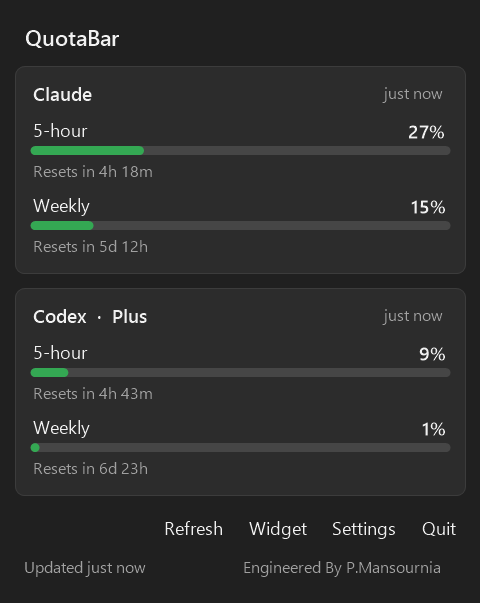
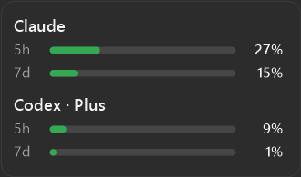
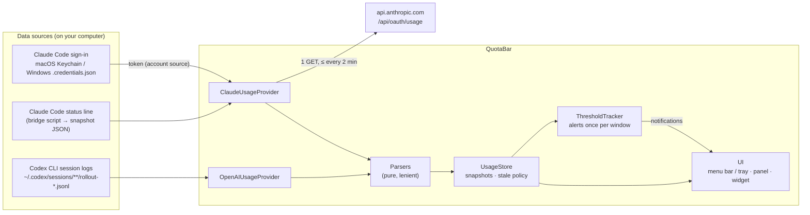

# QuotaBar

**See how much of your Claude and Codex usage limits you have left, right from the macOS menu bar or the Windows taskbar, without opening a terminal or a dashboard.**

[](https://github.com/Pouya-Mansournia/QuotaBar/actions/workflows/ci.yml)
[](LICENSE)
[](https://github.com/Pouya-Mansournia/QuotaBar/releases)


> [!NOTE]
> QuotaBar is an independent project. It is not affiliated with, endorsed by, or supported by Anthropic or OpenAI. "Claude" and "Codex" are trademarks of their respective owners. One optional data source uses an Anthropic endpoint that is not publicly documented and may change.

## What it does

QuotaBar shows the 5-hour and weekly usage limits of **Claude Code** and the **Codex CLI**, with countdowns to each reset. It reads data the tools already produce on your computer and alerts you at 80 / 90 / 95 % so you are not cut off mid-task. There is no account, backend, analytics or telemetry.

**Why it exists:** both tools have rolling quotas, but checking them means running a command or opening a settings page. QuotaBar keeps the numbers in view all the time.

## Screenshots

| macOS (light) | macOS (dark) |
| --- | --- |
|  |  |

| Windows panel | Windows desktop widget |
| --- | --- |
|  |  |

The macOS screenshots show Debug-only mock data (hence the MOCK badge) and are regenerated with `make screenshots`. The Windows screenshots are real readings.

## Download

| Platform | Get it |
| --- | --- |
| **Windows 10 / 11** | [QuotaBar-Setup-1.0.2.exe](https://github.com/Pouya-Mansournia/QuotaBar/releases/latest): per-user install, no admin rights |
| **macOS 14+** | Build from source (below), or `make dmg` for a disk image |

Neither build is code-signed by a paid certificate. Windows SmartScreen: **More info → Run anyway**. macOS: **System Settings → Privacy & Security → Open Anyway**.

## Features

| | macOS | Windows |
| --- | :---: | :---: |
| 5-hour and weekly usage, with reset countdowns | ✅ | ✅ |
| Always-visible readout | Menu bar title (`C 68 · O 42`, one provider, highest, or icon) | Tray gauge icon + draggable desktop widget |
| Detail panel | Menu bar popover | Flyout panel |
| Threshold notifications, once per quota window | ✅ per provider | ✅ |
| Last reading kept and marked stale when a refresh fails | ✅ | ✅ |
| Usage history with a chart | ✅ | Not yet |
| Launch at login | ✅ | ✅ |
| Light / dark mode | ✅ | ✅ (+ DPI scaling) |

### Supported providers

| Provider | 5-hour | Weekly | Reset time | Plan | Tokens / cost |
| --- | --- | --- | --- | --- | --- |
| Claude (Claude Code, Pro and Max) | Yes | Yes | Yes | No | No |
| Codex (Codex CLI, ChatGPT plans) | Yes | Yes | Yes | Yes | No |

Anything a source does not report is shown as **Unavailable**. QuotaBar never substitutes an estimate.

## Architecture

Both apps follow the same pipeline. Each provider either returns a complete reading or throws an error; parsers are pure functions; the store keeps the last good reading per provider.



| Layer | macOS (Swift 6, SwiftUI) | Windows (C# 12, .NET 8, WinForms) |
| --- | --- | --- |
| Composition root | `App/AppEnvironment.swift` | `App/TrayApplication.cs` |
| Providers | `Providers/Claude`, `Providers/OpenAI` | `Providers/` |
| Store / scheduling | `UsageStore`, `RefreshScheduler` | `UsageStore`, WinForms timer |
| Alerts | `ThresholdTracker` + UserNotifications | `ThresholdTracker` + tray balloon |
| UI | `MenuBarExtra`, Settings, History | Tray icon, `UsagePanel`, `UsageWidget`, `SettingsForm` (with credit and GitHub link) |

Design decisions such as lenient parsing, measured time vs read time, the two-minute request floor and never refreshing Claude Code's token are explained in [ARCHITECTURE.md](ARCHITECTURE.md).

## Quick start

### Windows

Download and run the [installer](https://github.com/Pouya-Mansournia/QuotaBar/releases/latest). If Claude Code is signed in on the PC, Claude usage appears immediately; Codex appears once the Codex CLI has been used. To build from source (.NET 8 SDK):

```powershell
cd Windows
dotnet test
dotnet run --project QuotaBar.Windows
```

Publishing a standalone exe and building the installer are described in [Windows/README.md](Windows/README.md).

### macOS

Requires macOS 14+ and Xcode 16+. No third-party dependencies.

```sh
git clone https://github.com/Pouya-Mansournia/QuotaBar.git
cd QuotaBar
make test       # unit tests
make run        # build Debug and launch
make install    # build Release, copy to /Applications, launch
make dmg        # build QuotaBar-<version>.dmg
```

Or open `QuotaBar.xcodeproj` and press Run. The Makefile uses `/Applications/Xcode.app` even if `xcode-select` points at the Command Line Tools; override with `DEVELOPER_DIR=…`. The app is signed ad hoc ("Sign to Run Locally"), so no Apple developer account is needed.

<details>
<summary>Installing from the macOS disk image</summary>

1. Open the disk image and drag **QuotaBar** to **Applications**.
2. Open QuotaBar. macOS blocks it the first time, because the build is not notarized by Apple.
3. Go to **System Settings → Privacy & Security**, scroll down, and click **Open Anyway** next to the QuotaBar message.

Or, in Terminal: `xattr -dr com.apple.quarantine /Applications/QuotaBar.app`

To ship without that step, set your team in the target's Signing settings, sign with a Developer ID and notarize.

</details>

## Setup

**Codex** works as soon as the Codex CLI has been used on the computer.

**Claude** has two sources (switch in **Settings**):

- **Anthropic account source.** Shows the same numbers as Claude Code's Account & Usage panel and works with the VS Code extension. On macOS the first launch offers **Connect Claude**, and macOS asks once to let QuotaBar read Claude Code's sign-in from the Keychain. On Windows it is the default and needs no prompt.
- **Status line bridge → Install.** No credentials and no network, but it updates only while Claude Code runs in a terminal. Send one message there after installing.

To start automatically, turn on **Launch at login** (on macOS, run `make install` first so the app has a stable location).

## Data sources

**Claude, account source.** QuotaBar reads the access token Claude Code stores (macOS Keychain, or `%USERPROFILE%\.claude\.credentials.json` on Windows) and sends one GET request to `https://api.anthropic.com/api/oauth/usage`, at most every two minutes. The token goes nowhere else and is never stored, logged or refreshed. Opt-in on macOS; default on Windows. An unrecognised response is shown as "Unsupported provider response", never as a guess.

**Claude, status line bridge.** Claude Code passes rate-limit usage, as documented JSON (`rate_limits`), to the command configured as its [status line](https://code.claude.com/docs/en/statusline). The bridge (a shell script on macOS, a PowerShell script on Windows) saves only the `rate_limits` object to QuotaBar's data folder and then runs your previous status line, so it keeps rendering. Installing edits `~/.claude/settings.json`; a backup is written next to it and **Remove** restores the previous value.

**Codex.** The Codex CLI records the rate-limit state returned with each response in its session logs. QuotaBar reads the most recent record. No credentials, no network.

Reading local data means values update when the tool is used on that computer; usage from the web apps or another device shows up the next time the CLI runs there. Claude Code sends no rate limits for API-key usage. Each reading shows its age, and once a window's reset time passes it is shown as reset instead of the old percentage.

## Repository structure

```text
QuotaBar/
├── QuotaBar/                 macOS app (Swift)
│   ├── App/                  entry point, composition root
│   ├── Core/                 models, store, persistence, notifications, security
│   ├── Providers/            Claude, Codex (OpenAI), Debug mock
│   ├── CLI/                  locating and running the CLIs
│   ├── Features/             menu bar, setup, settings, history, diagnostics
│   └── Resources/            asset catalog
├── QuotaBarTests/            macOS unit tests (XCTest)
├── QuotaBar.xcodeproj/
├── Windows/                  Windows app (C#)
│   ├── QuotaBar.Windows/     Core/, Providers/, App/
│   ├── QuotaBar.Windows.Tests/   xUnit tests
│   ├── installer/            Inno Setup script
│   └── dist/                 built installer
├── docs/                     screenshots
├── Scripts/                  icon generator
└── .github/                  CI, issue and PR templates
```

## Tech stack

- **macOS:** Swift 6, SwiftUI (`MenuBarExtra`), Swift Charts, UserNotifications, ServiceManagement, Security (Keychain), XCTest. No third-party dependencies.
- **Windows:** C# 12, .NET 8, WinForms, System.Text.Json, xUnit; installer built with Inno Setup 6.
- **CI:** GitHub Actions runs both test suites on every push and pull request.

## Testing

| | Command | Covers |
| --- | --- | --- |
| macOS | `make test` | parsers, account source, bridge (runs the real script), CLI locator, threshold tracker, store, formatting |
| Windows | `cd Windows && dotnet test` | parsers, account source, bridge (runs the real PowerShell script), threshold tracker, Codex log reading |

## Privacy and security

No backend, no analytics, no telemetry. The only network request is the Claude account source described above. Credentials are read-only and never written to disk or logs. Every file QuotaBar reads and writes is listed in [SECURITY.md](SECURITY.md). Report vulnerabilities privately through [GitHub security advisories](https://github.com/Pouya-Mansournia/QuotaBar/security/advisories/new).

## Limitations

- The Anthropic usage endpoint is undocumented and may change or be rate limited.
- Local sources only update when Claude Code / Codex run on the same computer.
- Builds are not notarized (macOS) or code-signed (Windows), so the first launch shows an OS warning.
- Usage history and per-provider alert settings are macOS only for now.

## Documentation

- [ARCHITECTURE.md](ARCHITECTURE.md): structure, data flow, design decisions, adding a provider
- [Windows/README.md](Windows/README.md): Windows build, installer and data locations
- [SECURITY.md](SECURITY.md): exactly what is read, written and sent
- [TROUBLESHOOTING.md](TROUBLESHOOTING.md): common problems
- [CHANGELOG.md](CHANGELOG.md): release history

## Contributing

Issues and pull requests are welcome. Read [CONTRIBUTING.md](CONTRIBUTING.md) and the [Code of Conduct](CODE_OF_CONDUCT.md) first.

## License

[MIT](LICENSE) © 2026 Pouya Mansournia

Engineered by **P.Mansournia**.
