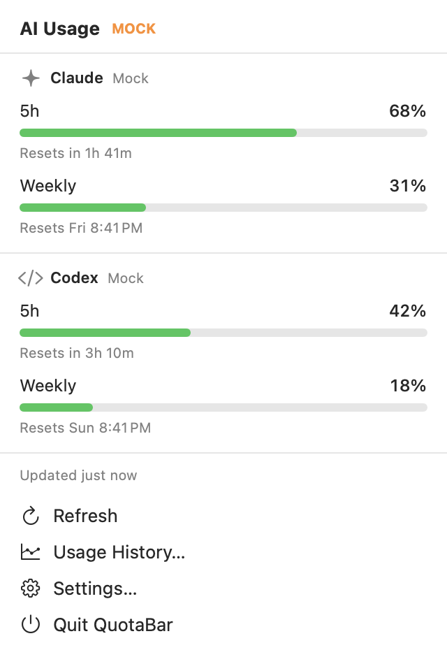
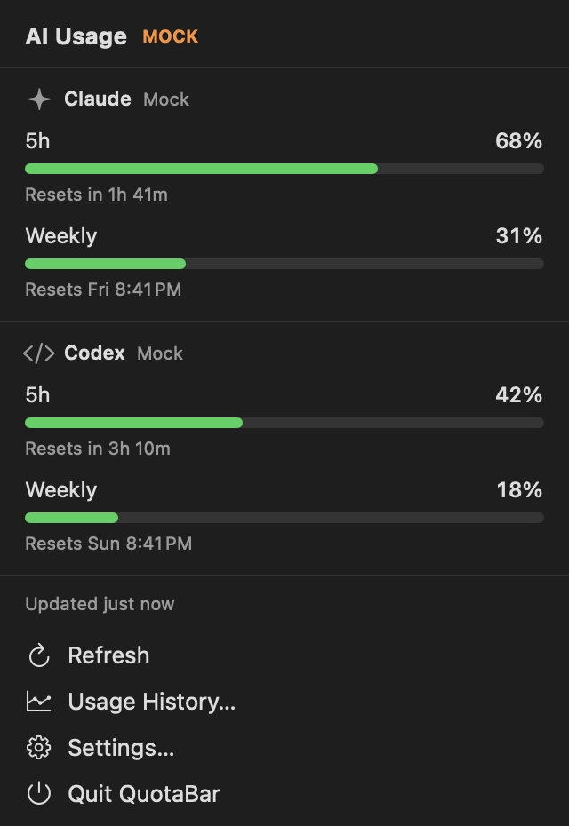

# QuotaBar

A native macOS menu bar app that shows how much of your Claude and Codex usage limits you have left, without opening a terminal or a dashboard.

| Light | Dark |
| --- | --- |
|  |  |

The screenshots show Debug-only mock data (hence the MOCK badge). They are regenerated with `make screenshots`.

- 5-hour and weekly usage for each tool, with reset countdowns
- Menu bar title: icon only, one provider, both (`C 68 · O 42`), or the highest value
- Notifications at 80 / 90 / 95 %, configurable per provider, once per quota window
- Last reading kept and marked stale when a refresh fails
- Local usage history with a chart
- Local by default: no sign-in, and no credentials or network access unless you turn on the Anthropic account source

## Requirements

- macOS 14 or later (Apple Silicon and Intel)
- Xcode 16 or later to build
- No third-party dependencies

## Build and run

```sh
git clone <repository-url>
cd QuotaBar
open QuotaBar.xcodeproj      # then press Run
```

Or from the command line:

```sh
make test       # unit tests
make run        # build Debug and launch
make install    # build Release, copy to /Applications, launch
```

The Makefile uses `/Applications/Xcode.app` even if `xcode-select` points at the Command Line Tools. Override with `DEVELOPER_DIR=…` if your Xcode lives elsewhere.

The app is signed ad hoc ("Sign to Run Locally"), so no Apple developer account is needed.

## Install from the disk image

`make dmg` builds `build/QuotaBar-<version>.dmg`. To install from it:

1. Open the disk image and drag **QuotaBar** to **Applications**.
2. Open QuotaBar. macOS blocks it the first time, because the build is not notarized by Apple.
3. Go to **System Settings → Privacy & Security**, scroll down, and click **Open Anyway** next to the QuotaBar message.

Or, in Terminal: `xattr -dr com.apple.quarantine /Applications/QuotaBar.app`

To ship without that step, set your team in the target's Signing settings, sign with a Developer ID and notarize.

## Setup

**Codex** works as soon as the Codex CLI has been used on this Mac.

The first launch opens a welcome window with a **Connect Claude** button. It explains the one macOS password dialog before it appears. That is all most people need.

**Claude** has two sources. To switch later, use **Settings → Claude**:

- **Read usage from my Anthropic account.** Shows the same numbers as Claude Code's Account & Usage panel and works with the VS Code extension. macOS asks you to let QuotaBar read Claude Code's sign-in from the Keychain.
- **Status line bridge → Install.** No credentials and no network, but it updates only while Claude Code runs in a terminal. Send one message there after installing.

See [Data sources](#data-sources) for what each one does.

To start QuotaBar automatically, run `make install` and turn on **Settings → General → Launch at login**.

## Supported providers

| Provider | 5-hour | Weekly | Reset time | Plan | Tokens / cost |
| --- | --- | --- | --- | --- | --- |
| Claude (Claude Code, Pro and Max) | Yes | Yes | Yes | No | No |
| Codex (Codex CLI, ChatGPT plans) | Yes | Yes | Yes | Yes | No |

Anything a source does not report is shown as **Unavailable**. QuotaBar never substitutes an estimate.

## Data sources

**Claude, account source (opt-in).** QuotaBar reads the access token Claude Code keeps in the Keychain and sends one GET request to `https://api.anthropic.com/api/oauth/usage`, at most every two minutes. The token goes nowhere else and is never stored or logged. This endpoint is not officially documented, so it may change; an unrecognised response is shown as "Unsupported provider response", never as a guess.

**Claude, status line bridge.** Claude Code computes rate-limit usage and passes it, as documented JSON (`rate_limits`), to the command configured as its [status line](https://code.claude.com/docs/en/statusline). That is the only documented place the numbers are exposed. The bridge is a small shell script that QuotaBar registers as the status line command. It saves the `rate_limits` object to `~/Library/Application Support/QuotaBar/claude-statusline.json` and then runs whatever status line you had before, so your own status line keeps rendering. Installing edits `~/.claude/settings.json`; a backup is written next to it and **Remove** restores the previous value.

**Codex.** The Codex CLI records the rate-limit state returned with each response in its session logs (`~/.codex/sessions/**/rollout-*.jsonl`). QuotaBar reads the most recent record.

Consequences of reading local data (the bridge and Codex):

- Values update when the tool is used on this Mac. Usage from the web apps or another device shows up the next time the CLI runs here.
- Claude data requires Claude Code running in a terminal and a Pro or Max subscription. The VS Code extension's chat panel does not run the status line, so extension-only sessions do not update the values. Claude Code sends no rate limits for API-key usage.
- Each card shows how old its reading is. Once a window's reset time passes, the card shows "Window reset · waiting for new data" instead of the old percentage.

## Privacy

By default QuotaBar makes no network requests and reads no credentials. The optional Anthropic account source reads Claude Code's sign-in token and sends it only to `api.anthropic.com`. There is no analytics or telemetry. Usage history stays in `~/Library/Application Support/QuotaBar`. Details are in [SECURITY.md](SECURITY.md).

## Documentation

- [ARCHITECTURE.md](ARCHITECTURE.md): structure, data flow, and how to add a provider
- [SECURITY.md](SECURITY.md): exactly what is read and written
- [TROUBLESHOOTING.md](TROUBLESHOOTING.md): common problems
